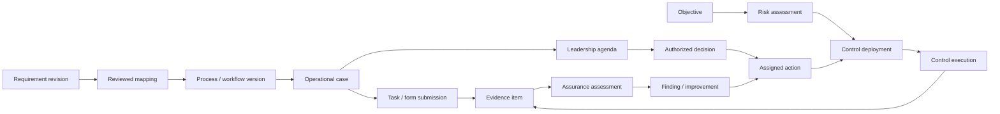

# ORR IMS public repository blueprint

| Control field | Value |
|---|---|
| Document ID / type / revision | ORR-FWK-REP-001 / FWK / r03 |
| Status / prepared | Draft — proposed structure, not implemented / 2026-10-30 |
| Purpose / scope | Preview the public edition's repository, data boundaries and future application structure |
| Module / deployment layer | Public-edition design / design-r01 unreleased / Layer 1 |
| Governing standard | ORR-STD-DOC-001 r02 public control draft; historical basis OIMS-STD-DOC-001 r05 |
| Owner / appointee | Public-edition product owner / Unassigned |
| Author | Codex at Edward's request |
| Reviewer / appointee | IMS architecture and data reviewer / Unassigned |
| Approver / appointee | Product governance authority / Unassigned |
| Approval / effective date | Not approved / Not effective |
| Classification / lifecycle | Public draft; organizational approval pending / Maintained |
| Index / canonical location | ORR-REG-REL-001 candidate inventory / this file |
| Review trigger | Before implementation or release; changed scope, data ownership or plugin interfaces |
| Source basis | User's IMS discussion and selected brand direction; original synthesis of private OIMS-FWK-APP-001 r01, not an export of its text |
| Supersedes / deviations | r02 retained in private publication snapshot / No content deviations; owner publication decision recorded below |
| Retention | Preserve assessed revisions and checks; no automatic disposal; custodian and schedule pending |

## 1. What this preview represents

The public edition is proposed as a **design-first project**, growing into an open
IMS core. The first candidate would explain the architecture, demonstrate a small
fictional evidence journey and invite contributions. It must not imply a working
IMS, complete normative requirements library or certification-ready organization.

Today this repository has project navigation, licensing/source notices, a draft
brand kit, implementation guidance, public document controls and this blueprint
with a small fictional JSON fixture. The interactive repository preview is local review
material. There is no application, SQLite database or plugin implementation. The owner
authorized draft repository publication; see GOVERNANCE.md for its limits. Future folders below are proposals;
an empty folder does not count as implementation.

## 2. Proposed repository layout

```text
orr-ims/                                 proposed remote/project name
├── README.md                            introduction, status and start here
├── LICENSING.md                         future scope and exclusions
├── LICENSES/                            exact authorized licence texts
├── NOTICE.md                            attribution and independence
├── CONTRIBUTING.md                      contribution and rights checks
├── GOVERNANCE.md                        actual maintainer decision process
├── SECURITY.md                          responsible reporting route
├── CODE_OF_CONDUCT.md                    participation expectations
├── .github/
│   ├── ISSUE_TEMPLATE/                  scoped proposals and reports
│   ├── PULL_REQUEST_TEMPLATE.md
│   └── workflows/                       automated checks
├── brand/                               draft kit exists
│   ├── ORR-STD-BRD-001_BRAND-GUIDE.md
│   ├── ORR-STD-BRD-001_TOKENS.json        canonical colour/design tokens
│   ├── ORR-STD-BRD-001_TOKENS.css         generated variables
│   └── assets/                          reviewed logo exports; proposed
├── docs/
│   ├── ORR-FWK-REP-001_REPOSITORY-BLUEPRINT.md
│   ├── ORR-FWK-REP-001_FICTIONAL-DATA.json
│   ├── design/                          purpose, architecture, ORCA, flows
│   ├── governance/                      scoped public document controls
│   ├── modules/                         public capability descriptions
│   └── plugin-contracts/                APIs/events/permissions, proposed
├── schemas/                             proposed versioned data contracts
│   ├── design/                          definitions and applicability
│   ├── operations/                      cases, tasks and decisions
│   ├── evidence/                        records and assurance
│   └── plugins/                         manifests and interface contracts
├── examples/                            explicitly fictional, proposed
│   ├── risk-to-leadership/
│   └── defect-to-maintenance/
├── releases/                            exact reviewed inventories
│
│   FUTURE SOFTWARE — not present or implemented
├── apps/
│   ├── web/                             TypeScript interface
│   └── server/                          authorized core API and services
├── packages/
│   ├── core/                            shared IMS services
│   ├── contracts/                       versioned shared schemas/events
│   ├── plugin-sdk/                      public extension interfaces
│   └── ui/                              shared accessible components
├── plugins/
│   └── example/                         original demonstration plugin only
├── database/
│   └── migrations/                      schema changes, not live databases
└── tests/                               workflow/contract/access checks
```

This is the intended shape, not a file inventory. Controlled authored documents
receive exact DocumentID prefixes. Conventional repository infrastructure names
are navigation/configuration, not substitutes for controlled IMS procedures.
The fixture is included beside this blueprint for discussion; broader example
packs and formal JSON Schemas have not been authored.

**Never put in the public payload:** actual organization databases, attachments,
client configuration, secrets, source publications/conversions, private discussion
records, commercial plugin source or private repository history. `.local/` contains
local review records and is excluded. Ignore rules alone are not a release check.

## 3. Modules and ownership

The two main user workspaces remain **IMS Design** and **IMS Operations**.

| Module group | Responsibilities | Repository representation |
|---|---|---|
| IMS Design | Source/edition references, scoped applicability, P01–P23 processes, controlled documents/forms, workflow versions, requirement mappings | Design docs first; schemas and core services later |
| IMS Operations | Cases, tasks, handoffs, risk/control records, discussions, meetings, decisions and actions | Journey docs/examples first; core services later |
| Evidence and assurance | Provenance, exact version links, verification, findings and health views | Data contracts/examples; future core services |
| Shared platform | Identity, scoped roles, permissions, audit history, plugin registry and integration events | Architecture/contracts; future platform code |
| Specialist plugins | CMMS, advanced business risk/opportunities and other specialist methods | Public contracts and capability descriptions; commercial implementations elsewhere |

All P01–P23 processes remain in design scope. Two examples demonstrate the approach;
they do not constitute implementation or detailed specification of all processes.
Preserve the four fundamentals, ten elements, twelve internal standards and four
deployment layers. This repository layout changes none of those identities.

Core owns common case/task coordination, decisions, actions, evidence envelopes
and audit events. A plugin owns its specialist records and exposes references and
events through the contract. An external CMMS may be the authoritative maintenance
provider. Do not create competing editable work-order masters in core and plugin.
One configured provider per scoped capability; absent capability remains a gap.

## 4. Files are not the operational database

Public JSON/CSV files hold definitions and fictional examples. Real organizational
records belong in that organization's controlled deployment, never in public Git.
The initial application direction is TypeScript with SQLite, with private attachment
storage outside the public checkout. No physical SQL schema or migrations are
created here; concurrency, tenancy, deployment and restore requirements remain open.

| Data group | Representative entities | Key linkage |
|---|---|---|
| Context and authority | organizations, scopes, users, role_assignments | Every case/decision is scoped; identity alone grants no approval authority |
| Requirements and design | source_editions, requirement_revisions, applicability_decisions, process_versions, workflow_versions, form_versions | A requirement maps to exact process/form/control revisions; applicability is explicit |
| ORCA | objectives, risks, risk_assessments, control_versions, control_deployments, risk_control_links | Objective → risk → deployed control → assurance |
| Work execution | process_cases, task_instances, handoffs, form_submissions | A case pins its workflow; each submission pins its form version |
| Leadership | meetings, agenda_items, decisions, actions | A risk can reach an agenda and authorized decision; discussion is not approval |
| Evidence | evidence_items, attachments, typed_evidence_links | Performer, observation time, record time, subject revision, origin and custodian |
| Assurance | assessments, results, findings, action_verifications | Evidence supports a scoped claim; completion is not automatically effectiveness |
| Plugins/integration | installations, capability_bindings, integration_links, outbox_events | Provider record IDs, contract versions, idempotency and reconciliation |



This is a relationship overview, not a physical schema; typed link tables resolve
many-to-many relationships. Versioned requirements and evidence must not be embedded
as uncontrolled text copies in every record. Publisher requirement text is not
part of this example.

## 5. Illustrative record structure

The paired [fictional JSON fixture](ORR-FWK-REP-001_FICTIONAL-DATA.json) links an
objective, risk, case, leadership agenda/decision, action, control and future
assurance request. It intentionally ends with **no operating evidence and a pending
assessment**, not an invented pass. All entries share `origin: fictional` and
`scope_id: scope-demo`. IDs have a `demo-` prefix; dates and actors are illustrative.

Minimum design conventions:

- Stable record ID plus separately versioned definitions and human-readable IDs.
- Exact `workflow_version_id`, `form_version_id` and `control_version_id` where used.
- Scope, origin, owner role, timestamps and explicit pending/unknown states.
- Separate `observed_at` from `recorded_at`; preserve corrections and predecessor.
- References resolve within authorized scope; actual data cannot inherit fictional
  evidence. Cross-organization links need explicit authority.
- Approval names the exact subject revision, authority and conditions; a meeting
  comment or completed task does not confer approval or show control effectiveness.
- Real evidence carries provenance and integrity metadata. A hash proves byte
  identity, not truth, sufficiency or an immutable database.

The fixture uses a small readable subset, not the final database or a normative
schema. It has no source-standard clauses, personal data, plant settings or actual
appointments. The actual reviewer must specify transactions, constraints, access,
retention, validation and migration before implementation.

## 6. Plugin contract proposal

Public manifest fields: stable plugin ID, version, core API compatibility range,
capabilities, declared permissions, owned record types, emitted/consumed event
versions, migrations, configuration schema, health hooks and licensing metadata.

Shared events carry event ID, schema version, provider, organization/scope,
subject ID/revision, actor, occurred/recorded times and correlation/idempotency keys.
Validate permission and schema on receipt, preserve provenance, reconcile retries
and surface integration failures. An event is not approval unless the governing
workflow and legitimate decision record say so.

CMMS may expose defect/work-order state and verified handback references; a risk
plugin may expose a scenario assessment and treatment proposal. Core decisions,
actions and evidence remain linked. Disabling or losing a plugin entitlement must
not silently erase history or abandon active work; exact lifecycle behaviour is a
future reviewed contract. No plugin loader, sandbox or database is implemented.

## 7. Proposed first release and acceptance

Candidate scope: clear README; original reviewed design explanations; this small
fictional data journey; reviewed brand exports; rights/licensing boundaries;
contribution, governance and security guidance; exact release inventory. Future
application folders enter only with actual code and checks. Neither the first
release scope nor the name is formally approved by this blueprint.

Before public release, close private-reference/control dependencies, verify each
file's source rights, scan the exact selection for secrets and personal data,
complete applicable audits, resolve blockers and obtain explicit publication
authorization. The private source workspace remains private. Publish no private
review evidence merely because it exists.

Author checks for this draft: local links/IDs, exact register entries, fixture
reference integrity and fictional origin, and browser preview interactions/reflow.
Retain hashes and results locally. Review by competent IMS/data reviewers, actual
appointments, final schemas and public release are pending. No independent review
or operating assurance is inferred from passing author checks.

FWK profile: purpose/scope §1; architecture/governance §§2–3; interactions/data
§§4–6; deployment and acceptance §7; sources/history §8. No deviations used.

## 8. Sources, records and history

Sources: user conversation, current ORR brand guide r03, private application-design
framework OIMS-FWK-APP-001 r01 and documentation standard OIMS-STD-DOC-001 r05.
Local assessment pins their exact bytes without copying their texts or private
indexes into this repository. Public-control/source clearance remains unresolved.

Preserve prior index, navigation and assessments before changing assessed versions.
Use the ORR-only preparation index, with product owner and document controller
roles unassigned. Retention schedule, backup and actual distribution arrangements
remain pending; do not automatically delete development evidence.

| Revision | Date | Change | Status |
|---|---|---|---|
| r01 | 2026-10-30 | Initial repository/data blueprint, fictional fixture and local visual preview | Draft; no application or public release |

| r02 | 2026-10-30 | Update supplied-content status, public control/inventory references and brand dependency | Draft; release acceptance pending |

Public controls: [ORR-STD-DOC-001 r02](governance/ORR-STD-DOC-001_DOCUMENT-CONTROL.md).
Distribution snapshot: [candidate inventory](governance/ORR-REG-REL-001_RELEASE-INVENTORY.csv).
The supplied public control draft resolves navigation availability; it does not
resolve source rights or confer competent review. See [SOURCES.md](../SOURCES.md)
for IOGP/IPIECA and ORCA attribution. Future folders in §2 remain proposals unless
listed as files in the current candidate inventory.

## Draft publication decision — r03

2026-10-30: Edward Wee authorized public draft distribution with recorded
unresolved risks accepted, superseding the earlier publication hold for this
selection. This decision does not close those findings, grant third-party rights
or approve organizational use. See [GOVERNANCE.md](../GOVERNANCE.md).
Earlier preparation/release-pending statements describe the retained drafting
context; this decision controls public distribution only. Previous r02 bytes
are retained in private history. Operational status remains Draft, not effective.
